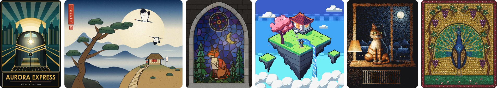
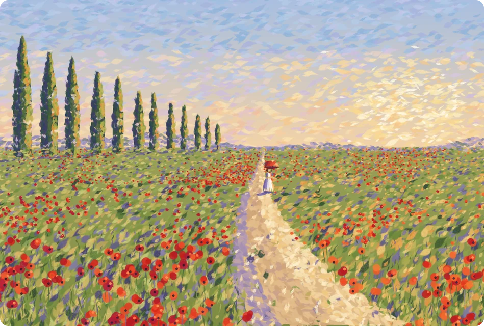
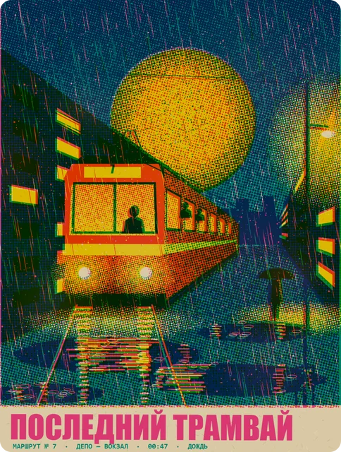
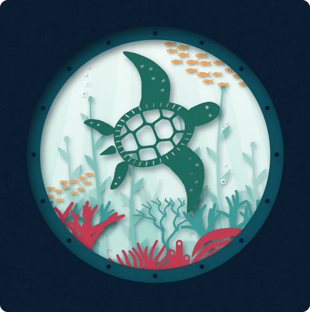
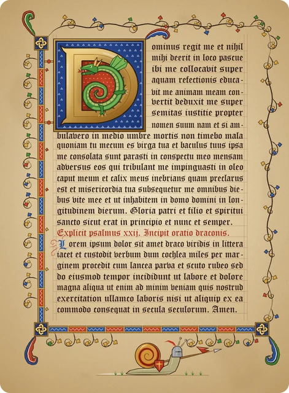
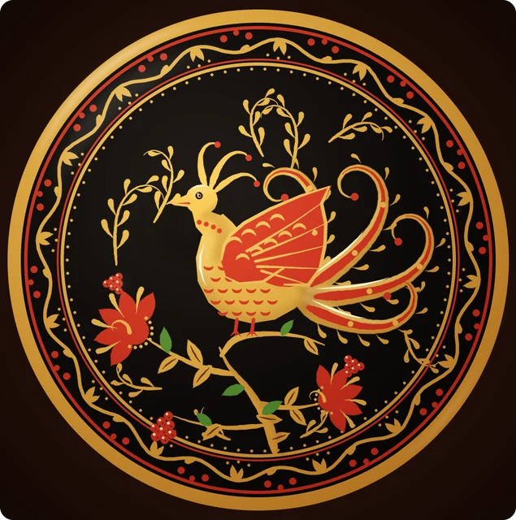
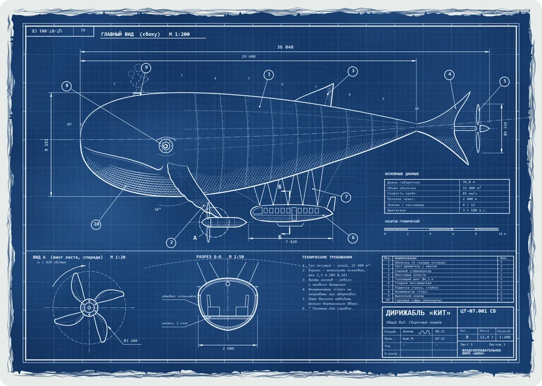
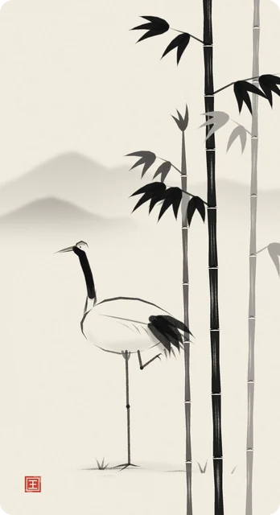
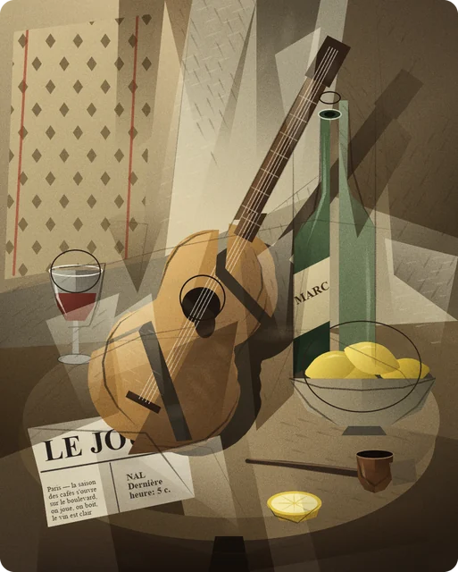

<h1 align="center">Agent Paint</h1>

<p align="center">
  <b>A headless painting engine for AI agents.</b><br>
  Layers, pressure-sensitive brushes, shapes, patterns and text, served as 22 MCP tools.<br>
  No window, no mouse, no GPU.
</p>

<p align="center">
  
</p>

<p align="center">
  
  
  
  
</p>

Every painting on this page was made by an AI agent through Agent Paint's tools, stroke by stroke
and shape by shape. No image model was involved.

## What it is

Agent Paint is a painting program made for agents rather than for a mouse. It keeps a real layered
document in memory (raster, vector and text layers, masks, blend modes, undo history) and lets an
agent work on it through a domain API: create a canvas, set up a brush, lay down strokes with
pressure, fill selections, hatch tones, set type, then take a snapshot and look at the actual
pixels before deciding what to fix.

It runs as a background process. Nothing is drawn on your screen, nothing takes over the mouse or
keyboard, and nothing depends on window focus, screen resolution or timing. It needs only a CPU and
Python on Windows or Linux (WSL included), and one server can hold many documents painted by
several agents at once.

The same engine is available three ways: as an **MCP server** (stdio or local HTTP) for Claude
Code, Codex and other MCP clients, as a **Python API**, and as a **JSONL plan runner** for
scripted work.

### Built for agents

- **A domain API instead of GUI automation.** Coordinates are document pixels, layers have stable
  ids and names, pressure and opacity are numbers from 0 to 1. There is no UI to click through and
  nothing to calibrate.
- **The agent sees its work.** `paint_snapshot` returns the real composite, or one layer, mask,
  selection or zoomed region, as an image. `paint_compare` puts a reference next to the painting,
  `paint_sample` reads colours.
- **Safe to experiment.** A call that changes the picture either completes or rolls back. A batch
  is one undo step. Errors come back as `isError` with an explanation of what to change.
- **Big plans in one call.** `paint_batch` runs up to 20,000 actions from a JSONL file, so an agent
  can compute geometry with a short script (mosaic tiles, hatching fields, halftone dots) and send
  it at once.
- **Many agents, one server.** Each document has its own lock and its own brush: parallel agents
  paint different pictures without waiting for or disturbing each other.
- **A painting skill included.** [`skills/agent-paint-reference`](skills/agent-paint-reference/SKILL.md)
  teaches an agent the workflow: plan the composition, values and palette, test marks, paint in
  passes, check snapshots and verify the saved file. It also carries style recipes and lessons from
  earlier studies.

## Gallery

Each picture began as a short text request, often just the name of a style. The agent planned the
composition, painted in passes and checked its own snapshots. Nothing was imported: every pixel
comes from a stroke, shape, fill, pattern, filter or text call. For the largest pieces the agent
wrote a small script that computes the geometry and sent it as batched plans. The peacock mosaic is
about 13,900 tesserae, the engraving about 13,000 pressure-modulated lines, the risograph about
73,000 strokes, mostly halftone dots. Click a picture to open it at full size.

<p align="center">
  <a href="docs/gallery/full/owl-engraving.jpg"></a>
  <a href="docs/experiments/2026-11-08-style-studies/02-impasto.png"></a>
  <a href="docs/gallery/full/risograph-last-tram.jpg"></a>
  <br><sub><b>Copper engraving</b> &nbsp;·&nbsp; <b>Impasto</b> &nbsp;·&nbsp; <b>Risograph with misregistration</b></sub>
</p>

<p align="center">
  <a href="docs/experiments/2026-11-08-style-studies/23-papercut.png"></a>
  <a href="docs/experiments/2026-11-08-style-studies/14-manuscript.png"></a>
  <a href="docs/experiments/2026-11-08-style-studies/18-khokhloma.png"></a>
  <br><sub><b>Paper cut</b> &nbsp;·&nbsp; <b>Illuminated manuscript</b> &nbsp;·&nbsp; <b>Khokhloma</b></sub>
</p>

<p align="center">
  <a href="docs/gallery/full/cyanotype-whale-airship.jpg"></a>
  <a href="docs/experiments/2026-11-08-style-studies/09-sumi-e.png"></a>
  <a href="docs/experiments/2026-11-08-style-studies/15-cubism.png"></a>
  <br><sub><b>Cyanotype blueprint</b> &nbsp;·&nbsp; <b>Sumi-e</b> &nbsp;·&nbsp; <b>Cubism</b></sub>
</p>

Full size of the pictures at the top:
[Art Deco poster](docs/experiments/2026-11-08-style-studies/04-art-deco.png) ·
[ukiyo-e](docs/gallery/full/ukiyo-e-cranes.jpg) ·
[stained glass](docs/gallery/full/stained-glass-fox.jpg) ·
[isometric pixel art](docs/gallery/full/isometric-teahouse.png) ·
[chalk pastel](docs/gallery/full/pastel-cat.jpg) ·
[Byzantine mosaic](docs/gallery/full/byzantine-peacock.jpg).
More: [30 style studies](docs/experiments/2026-11-08-style-studies/) painted by 30 agents working
in parallel.

## Features

**Document and layers**
- Raster, vector (editable shapes and strokes) and text layers; up to 128 layers and 32 megapixels
  per document
- Layer masks, clipping, alpha lock, opacity and 10 blend modes: normal, multiply, screen, overlay,
  soft light, darken, lighten, add, subtract, difference
- Merge down, flatten, "stamp visible" for whole-image effects; affine transforms of layers or
  selected pixels with nearest, bilinear or bicubic resampling

**Brushes and strokes**
- Seven brush kinds: round, pencil, airbrush, watercolor, marker, eraser, smudge
- Pressure controls size and opacity; tapers, flow, hardness, spacing, stabilisation, colour mixing
- Seeded texture, a paper grain fixed to the document for chalk, pastel and charcoal, watercolour
  edge darkening
- `smooth=true` draws a Catmull-Rom curve through the given points, pressure included (5–10 points
  give a clean curve); `dash` makes dashed and dotted lines
- Brush presets that can be saved, exported and imported

**Shapes, selections and fills**
- Rectangles, rounded rectangles, ellipses, polygons, lines and cubic Béziers; smooth organic
  outlines from a few points
- Pixel-exact mode (`antialias=false`) for pixel art and seamless tiling; `bleed` hides hairline
  seams between facets
- Selections: polygon, rectangle, ellipse, flood, layer alpha; add, subtract, intersect; feather,
  grow, shrink
- Fills: solid, flood, linear and radial gradients, clear to transparency

**Patterns and filters**
- Hatching and cross-hatching with hand-made jitter, breaks and tapers; stipple; halftone (Ben-Day
  and print dots); ordered dither in art-pixel cells
- Tone set by `density` or by a linear or radial gradient; patterns are anchored to the document,
  so neighbouring areas meet without seams
- Gaussian blur for glows and soft shadows, channel shift for chromatic aberration and
  misregistration, seeded noise, relief for impasto, linocut and paper cut

**Text**
- Unicode text in installed fonts or the bundled DejaVu Sans: outline, scale, rotation, letter
  spacing, line height, justification, baseline anchors
- Reports the text bounding box and warns about missing glyphs; `paint_fonts(supports="…")` finds
  fonts that contain every character you need

**Seeing and checking**
- Snapshots of the composite, a layer, a mask or a selection, whole or by region, with crisp
  upscaling of small crops
- Side-by-side comparison with a reference, colour sampling, named regions, view zoom and rotation

**Files**
- Native `.apaint` projects ([format](docs/format.md): a ZIP with a JSON manifest and PNG layers)
  keep layers, masks, vector objects, text and the brush editable; saves are atomic
- Export to PNG, JPEG, WebP and TIFF (with integer upscaling for pixel art), OpenRaster and PSD with
  layers; import images and OpenRaster files

**Reliability**
- Atomic calls and batches with rollback, undo and redo, `expected_revision` checks against
  concurrent edits, cancellation with `paint_abort`, a log of every call

## Quick start

You need Python 3.11 or newer. The dependencies (NumPy, Pillow and the MCP Python SDK) are
installed automatically.

Linux or WSL:

```bash
git clone https://github.com/Minebot17/agent-paint.git
cd agent-paint
python3 -m venv .venv
.venv/bin/python -m pip install -e .
```

Windows (PowerShell):

```powershell
git clone https://github.com/Minebot17/agent-paint.git
cd agent-paint
python -m venv .venv
.venv\Scripts\python -m pip install -e .
```

### Connect it to your agent

Your MCP client starts the server itself; register it once. Replace `/path/to/agent-paint` with
the clone's absolute path. On Windows the interpreter is `.venv/Scripts/python.exe`.

**Claude Code**

```bash
claude mcp add --scope user agent_paint -- /path/to/agent-paint/.venv/bin/python -m csp_headless.server --state-dir /path/to/agent-paint/.state
```

**Codex** (`~/.codex/config.toml`)

```toml
[mcp_servers.agent_paint]
command = "/path/to/agent-paint/.venv/bin/python"
args = ["-m", "csp_headless.server", "--state-dir", "/path/to/agent-paint/.state"]
```

**Other MCP clients** (Claude Desktop, Cursor and others)

```json
{
  "mcpServers": {
    "agent_paint": {
      "command": "/path/to/agent-paint/.venv/bin/python",
      "args": ["-m", "csp_headless.server", "--state-dir", "/path/to/agent-paint/.state"]
    }
  }
}
```

**Local HTTP** instead of stdio:

```bash
.venv/bin/python -m csp_headless.server --transport http --host 127.0.0.1 --port 8765
```

The endpoint is `http://127.0.0.1:8765/mcp`. The server binds to loopback only and has no
authentication; use a secure tunnel to reach it from another machine.

### Add the skill (recommended)

Copy the skill to where your agent looks for skills:

```bash
cp -r skills/agent-paint-reference ~/.claude/skills/   # Claude Code
cp -r skills/agent-paint-reference ~/.codex/skills/    # Codex
```

Then just ask, for example:

> Paint an original linocut of a lighthouse in a storm with Agent Paint, 1200×1600, and export a PNG.

The agent reads the built-in guide (the MCP resource `paint://guide`), creates its own document
and paints.

## Python API

```python
from csp_headless.engine import Engine

studio = Engine(".state")
studio.call("paint_document", action="create", width=800, height=600,
            name="Hello", background="#F3EAD7")
studio.call("paint_layer", action="create", name="ink")
studio.call("paint_brush", action="configure", color="#1E2A3A",
            settings={"size": 14, "pressure_size": True, "taper_end": 0.3})
studio.call("paint_strokes", layer_id="ink", smooth=True, strokes=[
    {"points": [[120, 420, 0.2], [260, 220, 1.0], [420, 360, 0.8], [640, 180, 0.1]]}])
studio.call("paint_shape", shape="ellipse", points=[[520, 330], [700, 510]],
            fill="#D9573B", layer_id="ink")
print(studio.call("paint_snapshot", label="first look").info["image_path"])
studio.call("paint_document", action="save", path="hello.apaint")
studio.call("paint_document", action="export", path="hello.png")
```

Always go through `Engine.call`: it handles locking, transactions, history, cancellation and
logging. Tool names and arguments are the same as over MCP.

## Scripted plans

A plan is a JSONL file with one `{"tool": "paint_...", "arguments": {...}}` per line:

```bash
.venv/bin/python -m csp_headless.cli scripts/example.jsonl --state-dir .state-plan
```

The runner prints JSON results and stops with exit code 1 at the first error. An agent can also
pass a plan file straight to the server with `paint_batch(actions_file=...)` (up to 20,000
actions, one undo step) or run it against a real MCP server with `scripts/mcp_plan.py`.
`scripts/demo.py` paints a 14-layer landscape and a brush sample sheet using only the public API.

<details>
<summary><b>All 22 MCP tools</b></summary>

| Tool | Purpose |
| --- | --- |
| `paint_state` | Documents, active layer, brush, limits and capabilities |
| `paint_document` | Create, select, close; open, save and inspect `.apaint`; import images and ORA; export |
| `paint_layer` | Raster, vector and text layers: order, visibility, opacity, blend, masks, clipping, alpha lock, merge, flatten, stamp visible |
| `paint_brush` | Brush kind, settings and colour; presets |
| `paint_strokes` | Pressure strokes: polyline or smooth spline, dashes and dots |
| `paint_shape` | Rectangles, ellipses, polygons, lines and Béziers; editable on vector layers |
| `paint_selection` | Polygon, rectangle, ellipse, flood, layer alpha; boolean operations; feather, grow, shrink |
| `paint_fill` | Solid, flood, linear and radial gradients, clear |
| `paint_pattern` | Hatching, cross-hatching, stipple, halftone and dither inside a shape or selection |
| `paint_filter` | Blur, channel shift, noise, relief |
| `paint_text` | Create and edit Unicode text |
| `paint_fonts` | Installed fonts, filtered by the characters they must contain |
| `paint_object` | Get, edit, duplicate or delete vector and text objects |
| `paint_transform` | Affine transform of a layer or selected pixels |
| `paint_history` | Undo and redo |
| `paint_batch` | Atomic batch: up to 256 actions inline or 20,000 from a file |
| `paint_snapshot` | Real pixels of the composite, a layer, mask or selection, whole or by region |
| `paint_compare` | A reference and the painting side by side |
| `paint_sample` | Colours at given points |
| `paint_region` | Named document regions stored in the project |
| `paint_view` | View zoom and rotation; drawing coordinates stay the same |
| `paint_abort` | Cancel running operations and roll them back |

</details>

## Performance

Agent Paint runs on the CPU (NumPy and Pillow) and needs no GPU. Version 0.4 went through a
two-stage memory and CPU audit and optimisation.

| | |
| --- | --- |
| Idle server | ≈ 52 MB RAM |
| A finished painting kept open (0.6–1.4 MP, 5–21 layers) | ≈ 20 MB median, 70 MB at most |
| Empty layer | 0 bytes |
| Undo history | at most 128 MB per document and 512 MB per server |
| One stroke call | ≈ 0.7 ms on any canvas size |
| Composite of a 3 MP, 20-layer picture | ≈ 50 ms |
| 4 agents painting 2400×1800, 13-layer pictures at once on one server | 11.5 s, 25 s of CPU time |

Compared with 0.3.0, an idle server uses 10× less memory, a single stroke call is 10–100× faster,
open paintings take 57% less memory, and the four-agent run is 6.8× faster (it took 78 s and 79 s
of CPU time). Documents left idle for 15 minutes are compressed in memory without loss. Measured
on a Ryzen 7 7700 under Windows 10; details in [docs/perf-audit.md](docs/perf-audit.md) (in
Russian), benchmark in [scripts/perf_audit.py](scripts/perf_audit.py).

## Tests

```bash
.venv/bin/python -m pip install -e ".[dev]"
.venv/bin/python -m pytest -q
```

206 tests, about 10 seconds.

## Repository layout

```text
src/csp_headless/   engine, renderer, tiled layers, .apaint storage, MCP server, JSONL runner
skills/             agent skill: painting workflow, style recipes, lessons from earlier studies
scripts/            demo, MCP plan runner, benchmark, Codex registration helper
docs/               file format, performance audit, painting log, gallery, 30 style studies
tests/              pytest suite
```

## Limitations

- An independent engine with its own brush renderers. It does not read `.clip` or `.sut` files and
  does not reproduce any other application's brushes pixel for pixel.
- No physical paint simulation: watercolour edges and paper grain are imitated, and colours mix in
  8-bit sRGB.
- CPU only. Canvases up to 32 MP work, but composites with many blend-mode layers on very large
  canvases take seconds.
- No 3D, animation or comic-page tools.

## Documentation

- `paint://guide`: the compact guide agents read, served as an MCP resource
- [docs/format.md](docs/format.md): the `.apaint` file format
- [docs/reference.ru.md](docs/reference.ru.md): detailed reference and version history (in Russian)
- [docs/perf-audit.md](docs/perf-audit.md): memory and CPU audit with measurements (in Russian)
- [docs/painting-experience.md](docs/painting-experience.md): what agents learned while painting (in Russian)

## About the name

The Python package is called `csp_headless` for historical reasons: the project started as a
desktop-free alternative to driving Clip Studio Paint through its user interface. Agent Paint
shares no code with Clip Studio Paint and is not affiliated with CELSYS, Inc.

DejaVu Sans is bundled under its own [license](src/csp_headless/assets/DejaVu-LICENSE.txt).
